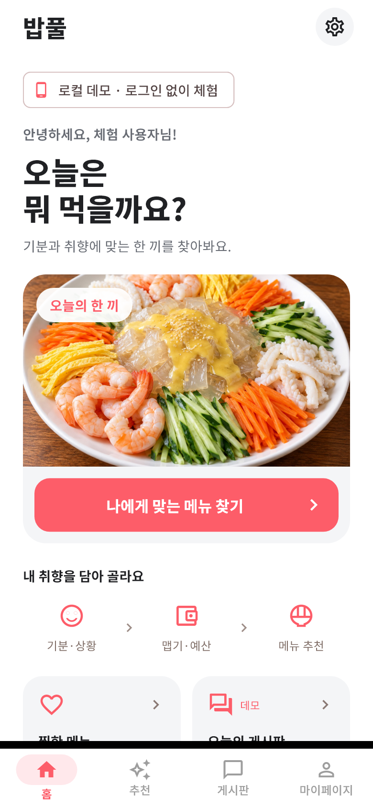
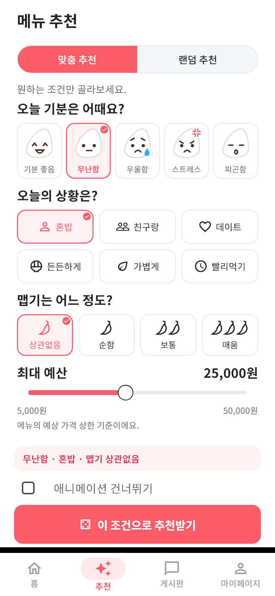
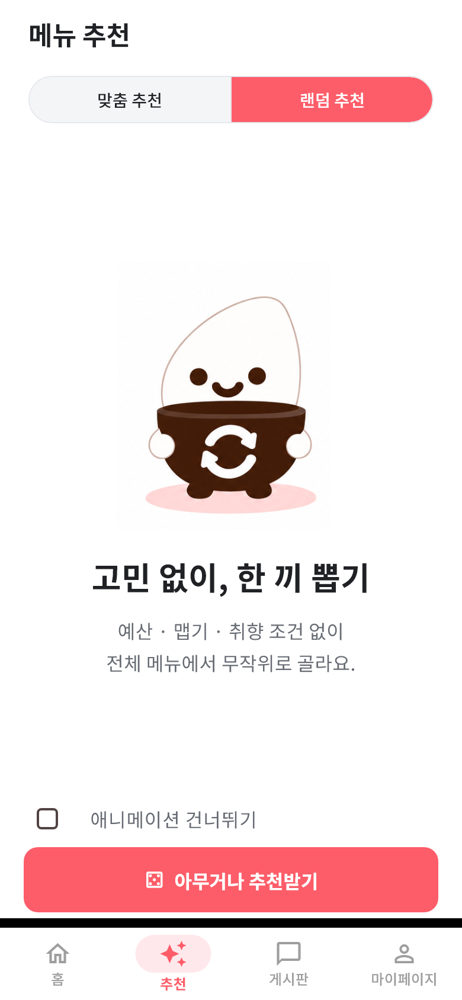
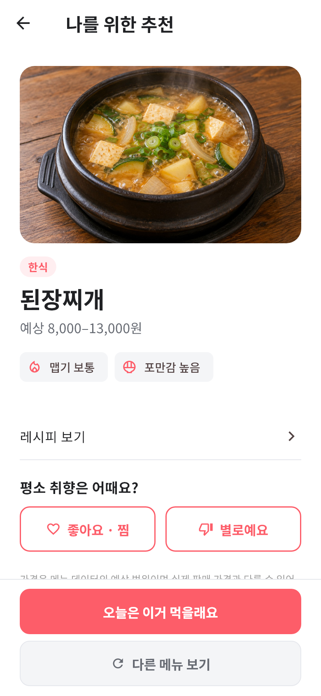
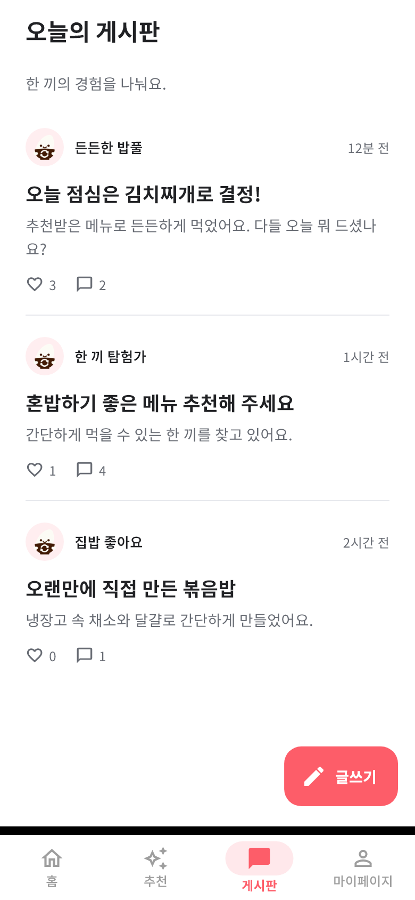
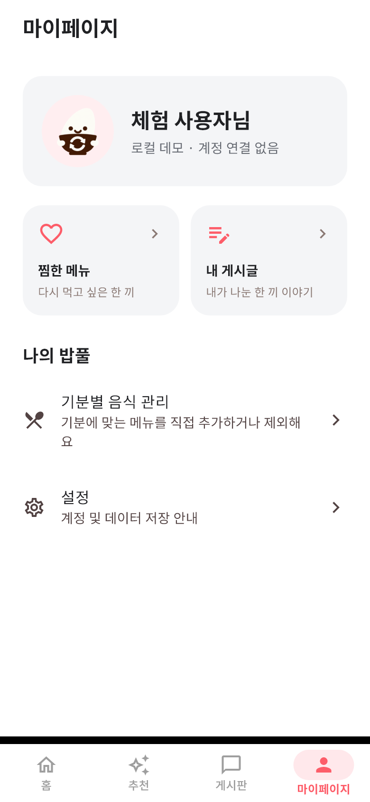

# Bob-pool · 밥풀

[한국어](#한국어) · [日本語](#日本語)

## 한국어

<table>
  <tr>
    <td width="120" align="center">
      
    </td>
    <td>
      <h2>밥풀 · Bob-pool</h2>
      
기분·식사 상황·예산에 맞춰 메뉴를 추천하는 안드로이드 앱입니다.

    </td>
  </tr>
</table>

무엇을 먹을지 고민할 때 조건에 맞는 메뉴를 추천받고, 레시피를 확인할 수 있습니다. 좋아요와 메뉴 선택 기록을 다음 추천에 반영합니다.

   

### 프로젝트 정보

| 항목 | 내용 |
|---|---|
| 프로젝트 | 4인 팀 졸업작품 |
| 개발 기간 | 4개월 |
| 개발 대상 | Android · 한국어 UI |
| 담당 역할 | 팀장 · 프론트엔드 개발 · 추천 알고리즘 설계 및 구현 · 학습 모델 설계 및 구현 |

   

### 사용 기술

<table width="100%">
  <tr>
    <td width="360" valign="top">
      <strong>운영체제</strong>
      
<code>Windows</code>

    </td>
    <td width="360" valign="top">
      <strong>개발 대상</strong>
      
<code>Android</code> 모바일 앱

    </td>
  </tr>
  <tr>
    <td valign="top">
      <strong>개발 도구</strong>
      
<code>Android Studio</code> <code>Visual&nbsp;Studio&nbsp;Code</code>

    </td>
    <td valign="top">
      <strong>프론트엔드</strong>
      
<code>Flutter</code> · <code>Dart</code>

    </td>
  </tr>
  <tr>
    <td valign="top">
      <strong>백엔드&nbsp;및&nbsp;데이터&nbsp;관리</strong>
      
<code>Firebase&nbsp;Authentication</code> <code>Cloud Firestore</code> <code>SharedPreferences</code>

    </td>
    <td valign="top">
      <strong>디자인</strong>
      
<code>Figma</code> · <code>Material 3</code>

    </td>
  </tr>
  <tr>
    <td valign="top">
      <strong>테스트 및 서버 관리</strong>
      
<code>Android Emulator</code> <code>Firestore Emulator</code> <code>Firebase&nbsp;Console</code>

    </td>
    <td valign="top">
      <strong>협업 도구</strong>
      
<code>Git</code> · <code>GitHub</code>

    </td>
  </tr>
</table>

   

### 주요 화면

기분·상황·맵기·예산을 한 화면에서 고를 수 있습니다. 추천 전 ‘애니메이션 건너뛰기’를 체크하면 음식 결과를 바로 보여주고, 체크하지 않으면 밥풀이가 자기 밥솥 버튼을 누른 뒤 결과로 전환합니다.

흰 배경과 Noto Sans KR로 통일한 현재 Flutter 화면을 로컬에서 렌더링했습니다. 게시판은 예시 데이터입니다.

  
  
  

  
  
  

   

### 핵심 담당 기능

- [추천 알고리즘](docs/contributions/recommendation.md)
- [피드백 학습](docs/contributions/feedback-learning.md)
- [게시판의 비동기 상태 처리](docs/contributions/board-async-state.md)

   

### 상세 자료

- [데이터 구조 (ERD)](docs/ERD.md)
- [APK 다운로드](docs/DOWNLOAD.md) — 일반·데모 버전 선택

Android 7.0 이상에서 사용할 수 있습니다. 서버 연결 APK는 설치 후 회원가입·로그인하며, 인터넷 연결이 필요하고 기록은 밥풀 서버에 저장됩니다. 데모의 기록은 기기에 저장됩니다.

---

## 日本語

<table>
  <tr>
    <td width="120" align="center">
      
    </td>
    <td>
      <h2>밥풀 · Bob-pool</h2>
      
気分・食事シーン・予算に合わせてメニューを提案するAndroidアプリです。

    </td>
  </tr>
</table>

何を食べるか迷ったときに、条件に合うメニューの提案を受け、レシピを確認できます。「いいね」とメニューの選択履歴を次の提案に反映します。

   

### プロジェクト情報

| 項目 | 内容 |
|---|---|
| プロジェクト | 4人チームの卒業制作 |
| 開発期間 | 4か月 |
| 開発対象 | Android・韓国語UI |
| 担当 | チームリーダー・フロントエンド開発・推薦アルゴリズムの設計と実装・学習モデルの設計と実装 |

   

### 使用技術

<table width="100%">
  <tr>
    <td width="360" valign="top">
      <strong>OS</strong>
      
<code>Windows</code>

    </td>
    <td width="360" valign="top">
      <strong>開発対象</strong>
      
<code>Android</code> モバイルアプリ

    </td>
  </tr>
  <tr>
    <td valign="top">
      <strong>開発ツール</strong>
      
<code>Android Studio</code> <code>Visual&nbsp;Studio&nbsp;Code</code>

    </td>
    <td valign="top">
      <strong>フロントエンド</strong>
      
<code>Flutter</code> · <code>Dart</code>

    </td>
  </tr>
  <tr>
    <td valign="top">
      <strong>バックエンド・データ管理</strong>
      
<code>Firebase&nbsp;Authentication</code> <code>Cloud Firestore</code> <code>SharedPreferences</code>

    </td>
    <td valign="top">
      <strong>デザイン</strong>
      
<code>Figma</code> · <code>Material 3</code>

    </td>
  </tr>
  <tr>
    <td valign="top">
      <strong>テスト・サーバー管理</strong>
      
<code>Android Emulator</code> <code>Firestore Emulator</code> <code>Firebase&nbsp;Console</code>

    </td>
    <td valign="top">
      <strong>共同開発ツール</strong>
      
<code>Git</code> · <code>GitHub</code>

    </td>
  </tr>
</table>

   

### 主な画面

気分・食事シーン・辛さ・予算を一つの画面で選べます。推薦前にアニメーションのスキップを選ぶと料理をすぐに表示し、選ばなければマスコットが自分の炊飯器のボタンを押してから結果に切り替わります。

白い背景とNoto Sans KRで統一した現在のFlutter画面をローカルで描画しました。掲示板はサンプルデータです。アプリのUIは韓国語です。

  
  
  

  
  
  

   

### 主な担当機能

- [推薦アルゴリズム](docs/ja/contributions/recommendation.md)
- [フィードバック学習](docs/ja/contributions/feedback-learning.md)
- [掲示板の非同期状態管理](docs/ja/contributions/board-async-state.md)

   

### 詳細資料

- [データ構造・ERD](docs/ja/ERD.md)
- [APKダウンロード](docs/ja/DOWNLOAD.md) — 通常版・デモ版を選択

Android 7.0以上で利用できます。サーバー接続版はインストール後に登録・ログインします。インターネット接続が必要で、記録はBob-poolのサーバーに保存されます。デモの記録は端末内に保存されます。
