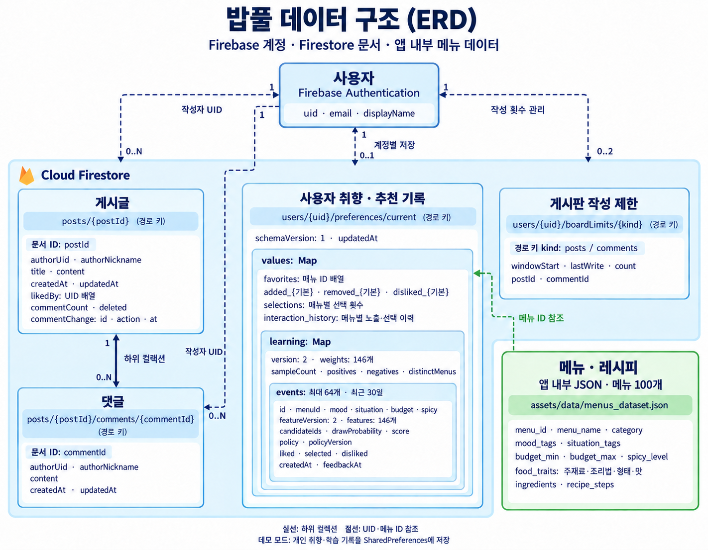

# 밥풀 데이터 구조 (ERD)

밥풀은 Firebase Authentication으로 계정을 관리하고 Cloud Firestore에 게시판과 계정별 취향·학습 기록을 저장합니다. 메뉴와 레시피는 앱에 포함된 JSON 파일에서 읽습니다.

   

## 저장 구조

| 데이터 | 저장 위치 | 관계 |
|---|---|---|
| 사용자 | Firebase Authentication | UID로 게시글·댓글 작성자와 개인 기록을 식별 |
| 게시글 | `posts/{postId}` | 사용자 한 명이 여러 글 작성. 좋아요는 `likedBy` UID 배열 |
| 댓글 | `posts/{postId}/comments/{commentId}` | 게시글의 하위 문서. 작성자는 `authorUid`로 식별 |
| 취향·추천 기록 | `users/{uid}/preferences/current` | 사용자별 문서 최대 1개. 찜·기분별 취향·선택·노출 이력 저장 |
| 학습 모델·반응 | 취향 문서의 `values.learning` | 내장 map에 모델 버전 2의 가중치 146개와 최근 30일 이내 노출·반응 기록 최대 64개 저장 |
| 작성 제한 | `users/{uid}/boardLimits/{kind}` | `posts`, `comments` 두 종류의 제한 기록. 마지막 작성 대상 ID와 횟수·시각 저장 |
| 메뉴·레시피 | `assets/data/menus_dataset.json` | 메뉴 100개. 취향·학습 기록은 메뉴 ID로 참조 |

그림은 Firestore의 문서 경로와 UID·메뉴 ID 참조를 표현한 논리 ERD입니다. SQL의 외래 키 제약을 의미하지 않습니다. `postId`, `commentId`는 문서 ID이며, `uid`, `kind`는 개인 문서의 경로 키입니다.

학습 모델과 반응 기록은 별도 컬렉션으로 분리되지 않습니다. `events`에는 노출 ID, 메뉴 ID, 입력 조건, 메뉴 특징, 후보 목록, 추첨 확률·점수·정책, 반응과 시각이 함께 저장됩니다. 그림에는 핵심 필드만 표시했습니다.

데모에서는 개인 취향·학습 기록을 SharedPreferences에 저장합니다. Firestore 경로는 서버 연결 모드를 기준으로 합니다.

   

## 코드와 상세 설계

- [계정 관리](../lib/services/auth_service.dart)
- [게시글 모델](../lib/models/post_model.dart) · [댓글 모델](../lib/models/comment_model.dart)
- [계정별 저장 구조](SERVER_PREFERENCES.md) · [저장 코드](../lib/services/firestore_preference_store.dart)
- [학습 모델](LEARNING_MODEL.md) · [기록 모델](../lib/models/learning_model.dart)
- [게시판 작성 제한](BOARD_SECURITY.md) · [제한 코드](../lib/services/board_write_limiter.dart)
- [로컬 메뉴 데이터](../assets/data/menus_dataset.json)
