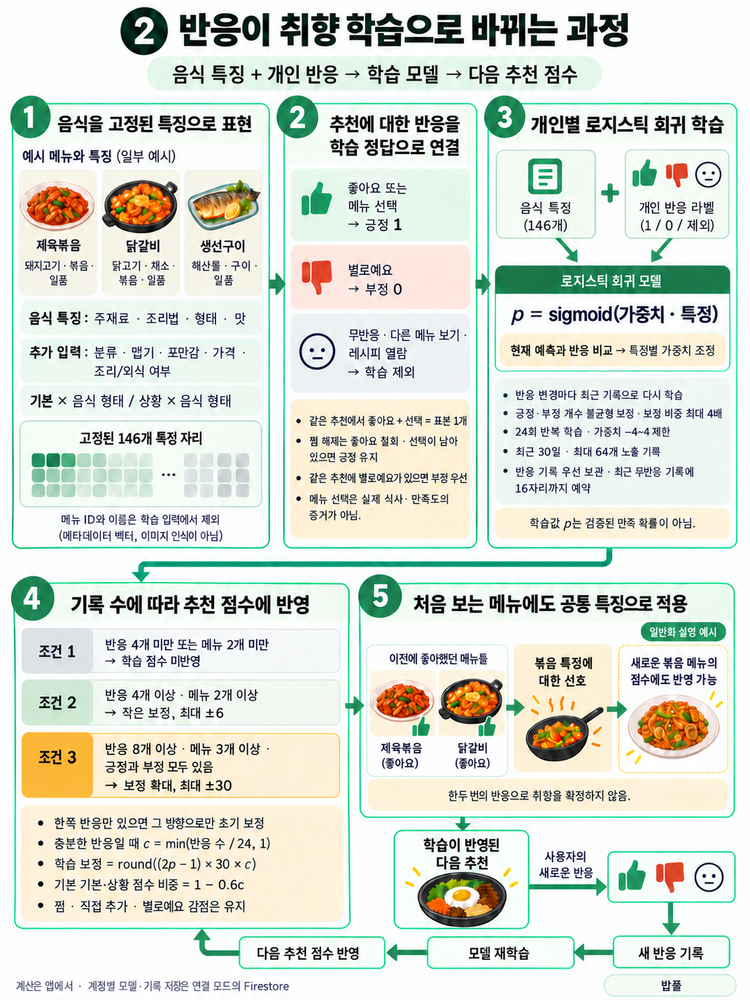
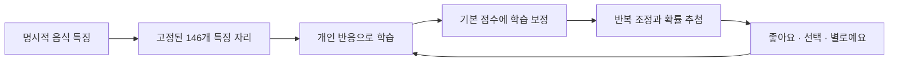

# 피드백 학습 모델





학습 모델은 `version=2`·146개 특징을 사용합니다. [서버 연결·데모 APK](APK.md)에서 같은 추천·학습 구조를 체험할 수 있습니다.

추천 알고리즘는 **계정별 콘텐츠 기반 로지스틱 회귀**로 사용자 반응을 학습한다.
사용자 반응으로 모델의 가중치를 실제로 맞추며, 예산·맵기·명시적 제외는 계속 필수 조건이다.
별도 유료 API나 학습 서버는 필요하지 않다. **학습 계산과 추론은 Flutter 앱의 Dart 코드에서 실행**하고,
연결 모드는 모델·추천 기록·취향 변경을 한 Firestore 트랜잭션으로 저장한다.
Firebase가 학습을 수행하거나 서버 작업이 주기적으로 실행되는 구조는 아니다.
데모는 같은 알고리즘을 사용하면서 기기에만 기록한다.

<br><br><br>


## 학습 입력과 반응

메뉴 데이터의 `food_traits`에 주재료·주요 조리법·음식 형태·맛의 성격을 명시한다. 기존 레시피를 바탕으로 메뉴 100개를 분류했다. 이 특징은 레시피를 설명하는 편집 자료다. 실제 식당의 모든 재료·영양·알레르기·채식 여부를 보장하지 않는다. 대체 주재료는 함께 기록하며 육수·양념·곁들임 전체를 나열하지 않는다. [음식 특징의 기준](FOOD_TRAITS.md)

메뉴 ID와 이름은 모델 입력에서 제외한다. 처음 보는 메뉴도 공통 음식 특징으로 평가한다. 해시 대신 [고정 특징 목록](../lib/models/learning_feature_schema.dart)에 각 특징의 자리를 하나씩 부여하고 L2 정규화한다. 총 146차원으로, 분류 12·주재료 9·조리법 8·음식 형태 8·맛 4·맵기 3·포만감 3·조리/외식 여부 2·예산 대비 가격 1·기분×음식 형태 48·상황×음식 형태 48을 사용한다. 특징 목록의 순서·의미를 바꾸려면 모델 버전도 변경해야 한다.

| 사용자 반응 | 학습 처리 |
|---|---|
| 좋아요 또는 메뉴 선택 | 긍정 표본 1 |
| 별로예요 | 부정 표본 0, 기존 -60점도 유지 |
| 같은 추천에서 좋아요 후 선택 | 긍정 표본 하나, 선택 횟수도 한 번 |
| 찜 해제 | 해당 좋아요 철회, 선택이 있으면 긍정 표본 유지 |
| 반응 없음·다른 메뉴 보기·레시피 열람 | 학습 정답 없음 |
| 긍정 반응 후 같은 추천에서 별로예요 | 부정 표본으로 변경 |
| 기분 설정 초기화 | 해당 기분의 학습 기록도 제거 |
| 기분에 메뉴 재추가 | 해당 기분·메뉴의 과거 부정 학습 제거 |

일반 찜 목록에서 해제하면 보관 중인 해당 메뉴의 좋아요를 철회한다.
랜덤 모드는 맞춤 조건·학습 점수를 적용하지 않으며 학습 표본도 생성하지 않는다.
이전 누적 선택 횟수에는 당시 추천 조건이 없어 학습 정답으로 자동 변환하지 않는다.
선택은 실제 식사·만족도의 증거가 아니며 이 모델은 명시적인 앱 반응을 학습한다.

<br><br><br>


## 모델 계산과 추천 반영

`p = sigmoid(w · x)`를 사용하고 로그 손실의 경사를 따라 가중치를 갱신한다.
반응 변경마다 최근 기록을 처음부터 다시 맞추어 좋아요 철회·부정 피드백·기록 만료를 반영한다.
최대 64개 노출 기록, 24회 학습 반복, 학습률 `0.4 / sqrt(epoch + 1)`, L2 규제 0.01,
가중치 [-4, 4] 제한을 사용한다. 긍정·부정이 모두 있으면 각 클래스의 학습 비중을 `min(전체 표본 수 / (2 × 해당 클래스 표본 수), 4)`로 조정하고, 한쪽 반응만 있으면 1을 사용한다. 많은 부정 반응 속에서도 적은 긍정 반응의 특징을 배울 수 있도록 하되 표본 수·학습 적용 조건은 실제 반응 수를 그대로 사용한다. 출력값은 클래스 비중을 보정한 학습 점수이며 사용자 만족 확률로 해석하지 않는다. 모두 초기 정책이며 사용자 실험으로 최적화한 값은 아니다.
[SGD와 로지스틱 회귀의 개념](https://scikit-learn.org/stable/modules/generated/sklearn.linear_model.SGDClassifier.html)을 참고했다.
scikit-learn 패키지 실행이나 모델 파일 변환 없이 Dart로 구현했다.

반응 표본 4개·서로 다른 메뉴 2개부터 작은 보정을 적용한다. 긍정 반응만 있다면 가점만, 부정 반응만 있다면 감점만 적용한다. 반응 없는 메뉴를 임의의 부정 표본으로 만들지 않는다. 초기 보정은 `round((2p - 1) × 6 × min(n / 8, 1))`을 최대 ±6점으로 제한하며, 한쪽 반응만 있을 때는 반대 방향의 점수를 0으로 제한한다.

반응 표본 8개 이상·긍정과 부정 각각 1개 이상·서로 다른 메뉴 3개 이상이면 더 큰 보정을 적용한다. `c = min(n / 24, 1)`일 때 `round((2p - 1) × 30 × c)`를 최대 ±30점 범위에서 더한다. 이때 기본 기분·상황 태그 점수는 `1 - 0.6c`배로 낮춘다. 표본 24개부터 기본 기분은 +12점, 상황은 +10점이 된다. 사용자가 기분에 직접 추가한 메뉴의 기분 +30점과 추가 +15점, 찜 +20점, 선택 횟수 점수, 별로예요 -60점은 유지한다.

표본 4개·메뉴 2개 조건 미달이거나 `LEARNING_ENABLED=false`이면 학습 보정과 태그 점수 축소를 적용하지 않는다. 학습 보정만으로 ‘별로예요’ -60점을 상쇄할 수 없다. 최종 추첨은 Softmax(온도 10) 90%와 탐색 후보 10%를 혼합한다. 탐색 대상은 [추천 설계](ALGORITHM.md)에 설명한다.
모델의 출력과 메뉴 추첨 확률은 서로 다르며, 둘 다 검증된 사용자 만족 확률이 아니다.
학습이 반영되면 기존 추천 이유 영역에 그 내용을 표시한다. 화면 배치는 변경하지 않았다.

<br><br><br>


## 서버 기록·중복·보관

기존 `users/<UID>/preferences/current` 문서의 `values.learning`에 저장한다.

```text
version=2 / weights[146] / sampleCount / positives / negatives / distinctMenus
events[최대 64]:
  id / menuId / mood / situation / budget / spicy
  featureVersion=2 / features[146] / candidateIds / drawProbability / score / policy
  policyVersion=3 (이전 기록은 당시 정책 유지)
  createdAt / feedbackAt / liked / selected / disliked
```

노출 ID는 추천을 추첨할 때 생성한다. 조건·실제 필터링한 후보 목록·추첨 확률·점수·특징을
그때 캡처하므로 반응 시점의 변경된 취향으로 과거 결정을 다시 계산하지 않는다.
보관 중인 동일 노출 ID의 재시도는 노출·선택 횟수와 학습 표본을 중복 증가시키지 않는다.
트랜잭션 콜백의 재실행도 분리된 데이터 사본으로 계산하므로 부분 저장이 없다.
보관 창에서 빠진 오래된 화면의 반응은 다시 추천받도록 거부한다. 메뉴별 `lastExposureId`와 마지막 추천 시각을 함께 확인해, 보관에서 밀려난 기록의 재전송이 노출 횟수를 다시 증가시키는 것을 막는다.

최근 30일 이내의 최대 64개 노출을 사용한다. 기록이 넘치면 반응이 있는 기록을 우선 보관하며, 최근 무반응 기록에 최대 16자리까지 예약한다. 따라서 무반응 추천을 많이 넘겨도 반응 기록 최대 48개가 보호된다. 반응 기록이 적으면 남는 자리에 무반응 기록을 더 보관하고, 모든 기록에 반응이 있다면 최대 64개를 보관한다. 30일이 지난 반응까지 영구 유지하는 구조는 아니다.

기존 `version=1`의 해시 가중치를 새 특징에 그대로 적용하지 않는다. 반응 기록의 메뉴 ID와 당시 기분·상황·예산·맵기로 특징을 재구성하고 새 모델을 다시 학습한다. 조회는 변환 결과만 사용하고 서버에 쓰지 않는다. 다음 정상적인 취향/반응 변경 때 같은 트랜잭션으로 버전 2를 저장한다. 찜·선택·노출 횟수와 기존 추첨 확률은 유지한다. 30일이 지난 기록과 현재 데이터셋에 없는 메뉴의 학습 기록은 새 학습에 포함하지 않는다. 알 수 없는 버전과 손상된 기록은 변환하지 않으며 명시적인 학습 초기화로 복구할 수 있다.

운영 규칙은 버전 1의 64개 가중치와 버전 2의 146개 가중치를 각각 허용한다. 연결 APK는 모델 버전 2를 사용한다. 기존 계정의 기록은 일괄 변경하지 않고, 앱의 다음 정상적인 기록 변경 때 변환한다. 이벤트의 `policy`는 기존 문자열을 유지하되 `policyVersion=3`으로 현재 추첨 정책을 구분한다.
만료·미래 시각의 기록은 추천 계산에서 제외하고, 다음 기록 변경 때 서버 문서에서도 제거한다.
**미사용 계정의 자동 삭제 작업이나 Firestore TTL은 구성하지 않았다.**
기분 초기화로 관련 학습을 지울 수 있으며 서비스의 `resetLearning()`은 전체 학습 기록과 모델을 초기화한다.
기존 찜·선택 이력은 별도의 취향 데이터로 남는다. 추가 UI는 만들지 않았다.

서버 규칙은 본인 접근과 모델 최상위 구조·버전·차원·표본 수·로그 수를 제한한다.
각 가중치·특징·이벤트 내부 값은 앱에서 검사하며, 서버가 학습 결과의 진위를 검증하는 구조는 아니다.
클라이언트 작성 데이터이므로 여러 사용자의 모델을 합치는 공용 학습 데이터로 바로 신뢰하면 안 된다.
알 수 없는 모델 버전·손상된 학습 데이터는 임의로 덮어쓰지 않는다.

<br><br><br>


## 비교와 재현

학습 점수 적용을 끄고 동일 UI로 규칙 점수와 비교할 수 있다. 두 모드 모두 10% 탐색을 사용하며, 기록 수집과 모델 갱신은 계속 수행한다.

```sh
flutter run --dart-define=DEMO_MODE=true --dart-define=LEARNING_ENABLED=false
flutter test --no-pub
dart run tools/evaluate_learning.dart
```

[합성 평가 결과](learning_evaluation.json)는 메뉴 100개 중 조건에 맞는 후보에서 시나리오별로 학습·검증 메뉴를 나눈다. ID 순서에서 매 3번째를 검증용으로 남긴다. 음식 특징으로 **인위적인 반응 규칙**을 생성하며 검증 메뉴 ID는 학습 표본에 포함하지 않는다. 돼지고기/해산물 비교에서는 둘 다 포함된 메뉴를 빼고, 구이/튀김 비교에서는 두 조리법만 비교한다. 평가는 학습 표본과 평가 표본을 분리한 조건에서 수행한다.

| 합성 시나리오 | 학습/검증 메뉴 수 | 균등 클래스 평균 로그 손실 | 규칙+탐색의 긍정 후보 확률 합 | 학습+탐색의 긍정 후보 확률 합 |
|---|---:|---:|---:|---:|
| 국물 음식 선호 | 56 / 28 | 0.1871 | 21.14% | 94.79% |
| 양식 선호 | 56 / 28 | 0.4259 | 0.84% | 20.61% |
| 볶음 선호 | 56 / 28 | 0.3990 | 33.79% | 70.06% |
| 돼지고기 긍정·해산물 부정 | 28 / 15 | 0.3586 | 72.94% | 96.87% |
| 구이 긍정·튀김 부정 | 8 / 5 | 0.2995 | 82.79% | 91.59% |

이 결과는 구현의 학습·일반화·추첨 반영 동작을 확인하는 기계적 평가다. 각 비율은 인위적인 선호 메뉴 집합에 할당된 추첨 확률의 합이며, 실제 추천 정확도나 만족도 개선율이 아니다. 균등 클래스 로그 손실은 긍정·부정 그룹의 평균 손실을 각각 구한 뒤 두 값을 동일 비중으로 평균한다. 반응 수가 많은 그룹이 평가를 지배하지 않게 하는 지표다. 일반 평균 손실과 클래스 비율 기준 손실도 JSON에 함께 기록한다. 양식의 일반 평균 손실은 0.3267로 클래스 비율 기준 0.2602보다 크다. 클래스 보정이 모든 평가 지표를 개선하는 것은 아니며 양식의 추첨 비중도 여전히 20.61%다.

모델은 사용자가 반응한 메뉴에서만 배우므로 노출 편향이 존재한다.
확률을 기록하지만 역확률 보정, 컨텍스트 밴딧, 인과 평가나 실제 A/B 실험은 구현하지 않았다.

<br><br><br>


## 코드와 검증 범위

- `lib/services/feedback_learning_engine.dart`: 특징·로지스틱 회귀·점수 보정·기록 만료.
- `lib/services/learning_feedback_recorder.dart`: 반응 정정·중복 방지·선택/취향과 모델의 한 트랜잭션 변경.
- `lib/models/learning_feature_schema.dart`: 146개 특징의 고정 순서.
- `lib/services/recommendation_diversity.dart`: 최근 추천의 음식 형태·조리법 비교.
- `test/mvp_recommendation_test.dart`: 특징 식별·재료/조리법 일반화·반응 불균형·반복 조정·필수 조건 보존.
- `lib/models/learning_model.dart`: 버전·유효성·노출 컨텍스트.
- `test/feedback_learning_engine_test.dart`: 미학습 메뉴 일반화·기분별 반대 취향·콜드 스타트·규칙 복귀·필수 조건.
- `test/learning_feedback_service_test.dart`: 서버 모델 재조회·계정 분리·재시도/실패·철회·복원·초기화·보관 한도.
- `test/widget_test.dart`: 기존 화면에서 추천 노출과 좋아요·선택을 연결하고 표본 하나만 생성하는지 확인.
- `tools/firebase_rules/rules.test.mjs`: 기존 문서 호환·본인 접근·모델 구조·두 클라이언트의 동시 이벤트 기록.

Mock·Emulator·합성 평가와 실제 Firebase 사용자 계정의 화면 검증은 [검증 기록](VERIFICATION.md)에서 구분한다.
