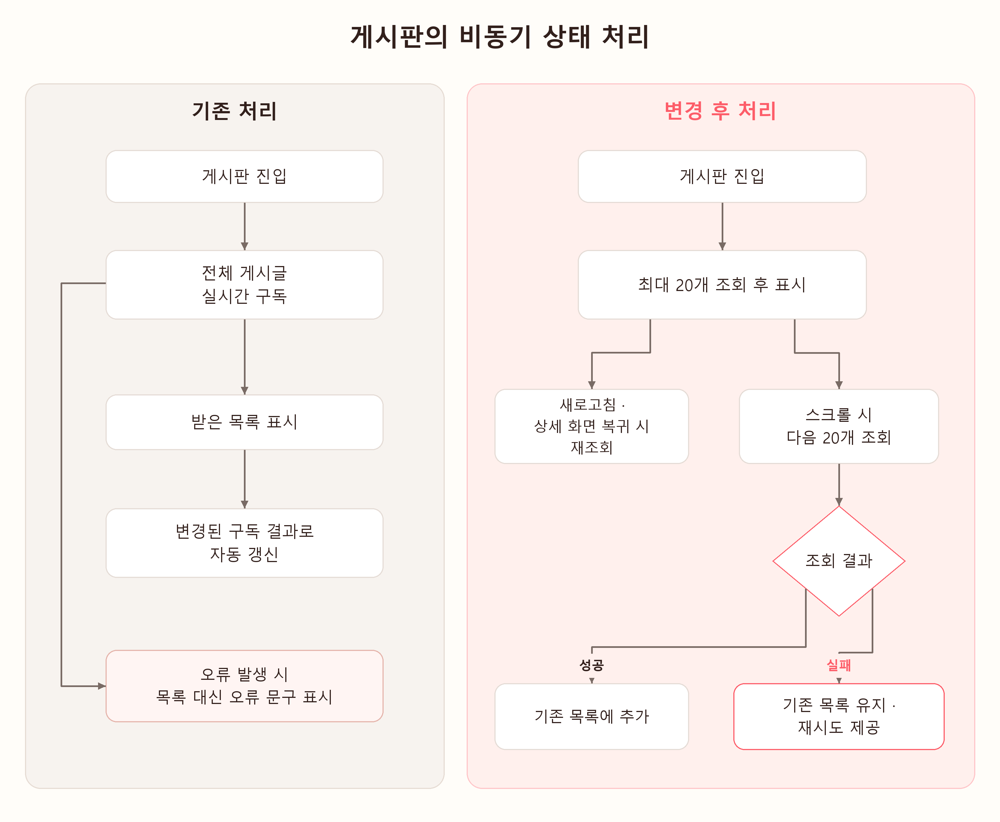

# 게시판의 비동기 상태 처리

   

## 처리 구조

게시글 전체를 실시간으로 구독하던 방식을 **20개 단위로 조회하고, 스크롤할 때 다음 페이지를 불러오는 방식**으로 변경했습니다.

페이지 조회로 전환하면서 로딩·중복 요청·재시도·새로고침 이전 응답을 공통 목록 위젯에서 관리했습니다.

   

## 기존 방식의 문제

기존에는 게시판에 들어오면 전체 게시글을 실시간으로 구독하고, 받은 목록을 화면에 표시했습니다.

게시글의 변경을 자동으로 반영할 수 있었지만, 데이터가 늘어날 때의 조회 범위와 오류 후 복구에 다음과 같은 한계가 있었습니다.

| 한계 | 원인 |
|---|---|
| 게시글이 쌓일수록 첫 조회에서 받아야 할 데이터가 늘어남 | `getPostsStream()`에 조회 개수 제한이 없어, 사용자가 최신 글 몇 개만 읽더라도 전체 게시글을 조회하고 모델로 변환함 |
| 조회 오류가 발생하면 기존 목록을 계속 보거나 직접 재시도하기 어려움 | `StreamBuilder`가 오류를 받으면 목록 대신 오류 문구를 표시하고, 사용자가 다시 불러올 재시도 버튼이나 당겨서 새로고침을 제공하지 않음 |

예를 들어 게시글이 100개라면 첫 화면에서 몇 개만 읽고 나가더라도 목록 쿼리는 100개를 조회했습니다.

   

## 해결 과정

전체 목록 구독을 페이지 조회로 바꾸고, 화면이 조회 결과를 반영하는 조건을 공통으로 관리했습니다.

### 1. 조회 상태를 공통 위젯으로 분리

기존 화면은 `StreamBuilder`에서 구독 상태에 따라 로딩·오류·빈 목록을 표시했습니다. 변경 후에는 `BoardPagedList`가 현재 목록, 로딩 여부, 오류, 마지막 조회 위치, 다음 페이지 유무를 관리하도록 구성했습니다.

게시판 화면은 조회 함수와 게시글을 표시할 위젯을 공통 목록 위젯에 전달합니다. 첫 조회의 로딩과 기존 목록 아래에 표시하는 추가 조회의 로딩도 구분했습니다.

### 2. 중복 요청과 실패 후 재시도를 처리

게시글은 20개씩 조회하고, 마지막으로 받은 문서를 커서로 사용해 다음 범위를 불러옵니다. 처음에는 한 페이지만 조회하며, 스크롤하거나 더 불러오기를 눌렀을 때 다음 페이지를 요청합니다.

조회 중에는 추가 요청을 차단하고, 더 받을 데이터가 없으면 조회를 멈춥니다. 추가 조회에 실패하면 이미 표시한 목록과 커서를 유지하고 재시도 버튼을 제공합니다. 재시도는 처음부터 전체 목록을 불러오는 대신 실패한 조회 위치에서 이어집니다.

### 3. 새로고침 이전의 응답을 구분

페이지 조회에서는 추가 조회가 끝나기 전에 새로고침이 실행될 수 있습니다. 이때 이전 요청의 응답을 그대로 추가하면 새로 조회한 목록에 이전 데이터가 섞일 수 있어 요청 세대를 구분했습니다.

새로고침할 때 목록과 커서를 초기화하고 `_generation` 값을 증가시킵니다. 응답이 도착하면 요청을 보낼 때 기록한 값과 현재 값을 비교해, 같은 세대의 결과만 화면에 반영합니다. 이미 보낸 요청을 취소하는 방식이 아니라 이전 응답을 반영하지 않는 방식입니다. 화면이 닫혔는지도 `mounted`로 확인합니다.

### 4. 화면 복귀와 새로고침 후 갱신

기존에는 목록의 실시간 구독으로 변경 사항을 반영했습니다. 페이지 조회로 바꾼 뒤에는 당겨서 새로고침하거나 글쓰기·상세 화면에서 돌아왔을 때 첫 페이지부터 다시 조회하도록 했습니다. 빈 목록도 스크롤 가능한 영역 안에 두어 게시글이 없어도 새로고침할 수 있습니다.

   

## 결과

### 1. 게시글 수가 늘어도 최초 조회를 최대 20개로 제한

실제 Android 기기와 Firestore 서버에서 **게시글 20개·100개·500개 조건을 추가해 기존 조회 방식과 비교**했습니다. 같은 SDK와 로그인 세션으로 기존 전체 구독의 첫 서버 응답과 현재 최대 20개 조회를 번갈아 실행했습니다. 각 조건에서 예열 4쌍을 제외한 20쌍을 집계했습니다.

| 게시글 수 | 기존 반환 | 현재 반환 | 기존 중앙값 | 현재 중앙값 | 응답 시간 감소율 |
|---|---:|---:|---:|---:|---:|
| 20 | 20개 | 20개 | 527.939ms | 529.021ms | -0.2% |
| 100 | 100개 | 20개 | 1,265.898ms | 486.253ms | 61.6% |
| 500 | 500개 | 20개 | 4,880.662ms | 461.766ms | 90.5% |

**게시글 20개에서는 두 방식의 응답 시간이 거의 같았고, 100개에서는 약 61.6%, 500개에서는 약 90.5% 감소했습니다.** 20개 조건의 -0.2%는 약 1.1ms 증가한 값으로, 작은 데이터에서도 일률적으로 빨라진다는 결과는 아닙니다.

구버전의 조회 코드를 같은 SDK에서 재현한 비교이며, 시간에는 네트워크와 SDK 처리가 포함됩니다. 한 기기·한 세션의 첫 조회 응답 비교로, 앱 전체의 속도 개선율은 아닙니다. [게시글 수별 조회 결과](../evaluations/BOARD_SERVER_SCALE_COMPARISON.md)

### 2. 추가 조회 실패 시 기존 목록 유지와 재시도 지원

기존에는 조회 오류가 나면 목록 대신 오류 문구가 표시됐습니다. 변경 후에는 다음 페이지 조회가 실패해도 이미 읽던 목록을 유지하고, 목록 아래의 다시 시도 버튼으로 실패한 조회를 다시 요청할 수 있습니다. 첫 조회 실패에도 다시 시도 버튼을 제공합니다.

위젯 테스트에서 다음 페이지 조회에 오류를 발생시킨 뒤, 기존 항목이 화면에 남아 있는지와 다시 시도한 결과가 목록에 추가되는지를 확인했습니다.

| 확인한 상황 | 결과 |
|---|---|
| 다음 페이지 조회 실패 | 이미 표시한 항목 유지 |
| 오류 후 다시 시도 | 성공한 조회 결과를 기존 목록에 추가 |
| 빈 목록에서 당겨서 새로고침 | 다시 조회한 게시글 표시 |

   

## 실제 코드 보기

| 코드 | 구현 내용 |
|---|---|
| [게시글 조회 서비스](../../lib/services/post_service.dart) | 20개 단위 조회, 정렬과 커서 처리 |
| [공통 목록 위젯](../../lib/widgets/board/board_paged_list.dart) | 로딩·오류·재시도, 중복 요청 방지, 이전 응답 무시 |
| [게시판 화면](../../lib/screens/board_page.dart) | 페이지 목록 연결, 화면 복귀 후 갱신 |

---

[핵심 담당 기능으로 돌아가기](../../README.md#핵심-담당-기능)
