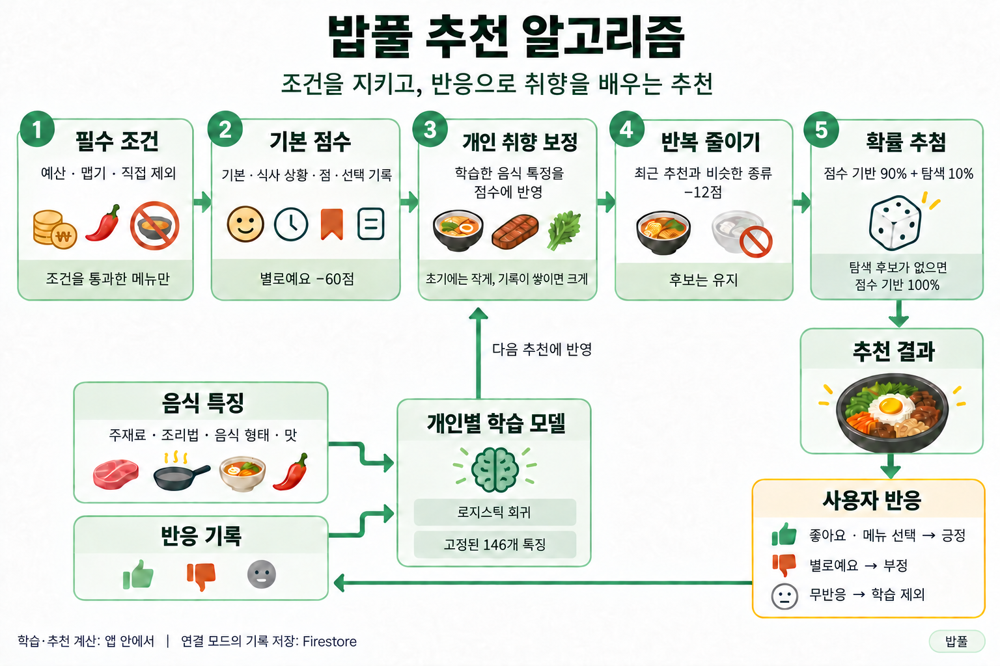

# 추천 알고리즘

   

## 알고리즘 구조

예산·맵기·직접 제외한 메뉴를 먼저 확인하고, 조건을 통과한 메뉴에 기분·상황·개인 취향을 반영한 점수를 부여합니다. 최근 추천과 비슷한 메뉴의 점수를 낮춘 뒤 확률 추첨으로 최종 메뉴를 선택합니다. 좋아요·메뉴 선택·별로예요 반응은 다음 추천에 반영합니다.

   

## 기존 알고리즘의 문제

기존에는 메뉴에 미리 지정한 기분·식사 상황 태그와 입력 예산의 일치 여부를 우선순위별로 확인했습니다. 모든 조건을 만족하는 후보가 없으면 조건을 단계적으로 완화하고, 처음 후보가 나온 단계에서 메뉴를 무작위로 선택했습니다. 불호 메뉴 제외와 기분별 메뉴 추가·제거도 지원했습니다.

구현이 단순하고 추천 기준을 설명하기 쉬웠지만, 다음과 같은 한계가 있었습니다.

| 한계 | 원인 |
|---|---|
| 선호를 다른 음식으로 확장하기 어려움 | 불호 제외와 수동 태그 설정은 가능하지만, 좋아요·선택 기록과 음식 특징을 이용해 새로운 메뉴의 선호를 학습하지 않음 |
| 같은 음식이 반복되기 쉬움 | 처음 조건을 만족한 후보 안에서 추첨하고, 최근 노출 기록과 음식 종류의 반복은 확인하지 않음 |
| 최대 예산의 의미와 가격 검사가 다름 | 입력 예산이 메뉴 가격 범위 안에 있는지 검사해 메뉴 가격 상한이 예산을 넘어도 후보가 될 수 있고, 후보가 없으면 예산 조건도 완화함 |

   

## 해결 과정

태그만으로는 개인의 취향과 추천의 다양성을 함께 반영하기 어렵다고 보고, **입력 조건은 지키면서 사용자 반응에 따라 추천이 달라지는 구조**를 구상했습니다.

### 1. 반드시 지킬 조건과 취향 판단을 분리

예산과 맵기, 사용자가 직접 제외한 메뉴는 추천 전에 검사하도록 분리했습니다. 기분과 식사 상황은 후보를 좁히는 유일한 기준으로 두지 않고 점수에 반영했습니다. 취향 점수가 높더라도 필수 조건을 벗어난 음식은 추천되지 않도록 했습니다.

### 2. 태그 일치에 개인 반응을 함께 반영

기분·상황에 따른 기본 점수에 찜과 선택 기록은 가점으로, 별로예요는 감점으로 반영했습니다. 처음에는 기본 점수로 추천하고, 반응이 쌓이면 음식의 주재료·조리법·형태·맛을 학습한 보정 점수를 더하도록 구성했습니다. 충분한 긍정·부정 반응이 모이면 공통 태그의 영향은 줄이고 개인 반응의 영향을 키웠습니다.

### 3. 좋아하는 음식도 반복해서 나오지 않도록 조정

선호 점수만 높이면 같은 음식이 계속 나올 수 있어 최근 추천·선택 기록을 함께 확인했습니다. 최근에 나온 메뉴와 비슷한 종류의 음식은 점수를 낮추고, 같은 재추천 세션에서 이미 본 메뉴는 제외해 다른 음식을 살펴볼 수 있도록 했습니다.

### 4. 최고 점수 하나를 고르는 대신 확률로 선택

항상 최고 점수 메뉴만 고르면 추천이 고정될 수 있어 Softmax로 점수를 추첨 확률로 바꿨습니다. 점수가 높은 메뉴에 더 큰 확률을 주면서 다른 후보에도 기회를 남겼습니다.

추첨 확률의 90%는 점수를 기준으로, 10%는 노출이 적은 탐색 후보에 배분했습니다. 탐색 대상에서도 필수 조건 위반, 부정 반응, 최근 추천·선택과 비슷한 음식 등을 확인하며, 탐색 후보가 없으면 점수 기반 확률만 사용합니다.

   

## 결과

팀원들이 직접 사용해 본 결과, 같은 기분과 식사 상황에서도 이전보다 다양한 메뉴를 추천받을 수 있었습니다. 기존 태그 일치 방식에서 추천의 폭을 넓혀, 한 끼를 고를 때 더 다양한 음식을 살펴볼 수 있게 됐습니다.

좋아요·메뉴 선택·별로예요 기록을 남긴 뒤에는 각자의 선호와 불호가 추천에 더 잘 반영된다는 평가를 받았습니다. 메뉴의 다양성과 개인 취향을 함께 고려한 추천이 팀원들의 실제 사용 경험에서도 긍정적으로 받아들여졌습니다.

### 비교 테스트

팀원 후기와 별도로, 원본 추천 코드를 변경 없이 실행해 추천 알고리즘과 비교했습니다. 기분 5개·상황 6개, 최대 예산 25,000원 조건에서 각 방식으로 100회 추천을 20번씩 수행했습니다.

| 지표 | 원본 추천 | 추천 알고리즘 | 변화 |
|---|---:|---:|---:|
| 100회 추천에서 서로 다른 메뉴 수 | 평균 3.43개 | 평균 59.71개 | **약 17.4배** |
| 비슷한 음식의 연속 추천률 | 70.46% | 6.72% | 63.73%p 감소 |
| 동일한 가상 취향 기록을 반영한 선호 음식 추천 비율 | 평균 20.00% | 평균 79.27% | **59.27%p 상승** |

다양성 수치는 30개 입력 조건의 평균입니다. 원본의 가격 범위 검사와 현재의 최대 예산 검사가 후보 범위를 다르게 만드는 영향도 포함됩니다. 10,000~50,000원의 다른 예산에서도 추가 비교했으며, 개선 폭은 예산마다 달랐습니다.

선호 음식 비율은 가상 취향 5종에 대해 각 방식에 동일한 좋아요·불호 기록을 제공하고, 시나리오별로 2,000회 추천한 평균입니다.

[테스트 조건과 전체 결과 보기](../evaluations/ORIGINAL_RECOMMENDATION_COMPARISON.md)

   

## 실제 코드 보기

| 코드 | 구현 내용 |
|---|---|
| [추천 엔진](../../lib/services/recommendation_engine.dart) | 필수 조건 필터, 기분·상황·취향 점수, 학습 보정과 최근 기록 반영 |
| [음식 종류의 반복 조정](../../lib/services/recommendation_diversity.dart) | 최근 추천과 비슷한 음식인지 판단 |
| [확률 추첨](../../lib/services/softmax_sampler.dart) | Softmax 확률 계산과 탐색 확률 배분 |
| [추천 흐름 연결](../../lib/services/local_recommend_service.dart) | 메뉴·취향 불러오기, 후보 계산, 추첨과 추천 기록 구성 |
| [피드백 학습](../../lib/services/feedback_learning_engine.dart) | 음식 특징과 개인 반응으로 학습 보정 계산 |

---

[핵심 담당 기능으로 돌아가기](../../README.md#핵심-담당-기능)
