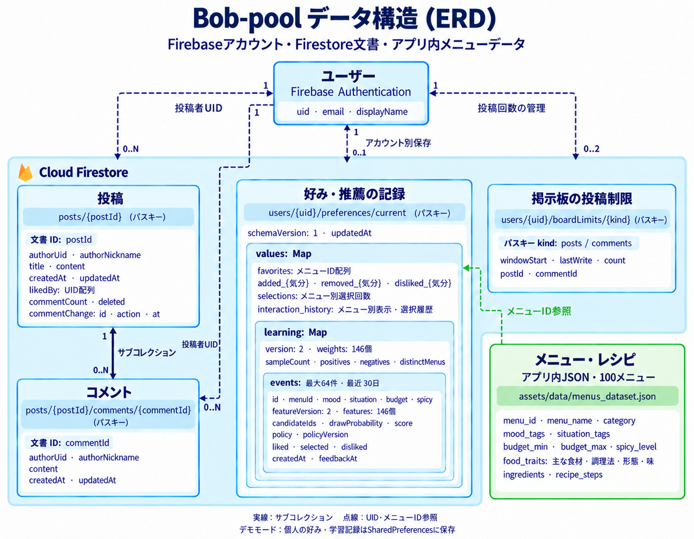

# Bob-poolのデータ構造（ERD）

Firebase Authenticationでアカウントを管理し、Cloud Firestoreに掲示板とアカウント別の好み・学習記録を保存します。メニューとレシピはアプリ内のJSONから読み込みます。

   

## 保存構造

| データ | 保存先 | 関係 |
|---|---|---|
| ユーザー | Firebase Authentication | UIDで投稿・コメントの作者と個人の記録を識別 |
| 投稿 | `posts/{postId}` | 一人のユーザーが複数投稿。いいねは`likedBy`のUID配列 |
| コメント | `posts/{postId}/comments/{commentId}` | 投稿の下位文書。作者は`authorUid`で識別 |
| 好み・推薦記録 | `users/{uid}/preferences/current` | ユーザーごとに最大1文書。お気に入り、気分別の好み、選択・表示履歴 |
| 学習モデル・反応 | 好み文書の`values.learning` | 内部mapにモデルバージョン2の重み146個と、最近30日以内の表示・反応を最大64件保存 |
| 投稿制限 | `users/{uid}/boardLimits/{kind}` | `posts`と`comments`の二種類。最後の投稿先ID、回数、時刻を保存 |
| メニュー・レシピ | `assets/data/menus_dataset.json` | 100メニュー。好み・学習記録はメニューIDで参照 |

図はFirestoreの文書パスとUID・メニューIDの参照を表した論理ERDです。SQLの外部キー制約を意味しません。`postId`と`commentId`は文書ID、`uid`と`kind`は個人文書のパスキーです。

学習モデルと反応は別コレクションには分けません。`events`には表示ID、メニューID、入力条件、料理の特徴、候補、抽選確率・スコア・ポリシー、反応、時刻をまとめて保存します。図は主要フィールドのみを示しています。

デモでは個人の好み・学習記録をSharedPreferencesに保存します。図のFirestoreパスはサーバー接続モードの構造です。

   

## コードと詳細設計

- [アカウント管理](../../lib/services/auth_service.dart)
- [投稿モデル](../../lib/models/post_model.dart)・[コメントモデル](../../lib/models/comment_model.dart)
- [アカウント別保存](SERVER_PREFERENCES.md)・[保存コード](../../lib/services/firestore_preference_store.dart)
- [学習モデル](LEARNING_MODEL.md)・[記録モデル](../../lib/models/learning_model.dart)
- [掲示板の投稿制限](BOARD_SECURITY.md)・[制限コード](../../lib/services/board_write_limiter.dart)
- [ローカルメニューデータ](../../assets/data/menus_dataset.json)

---

[詳細資料に戻る](../../README.md#詳細資料)
