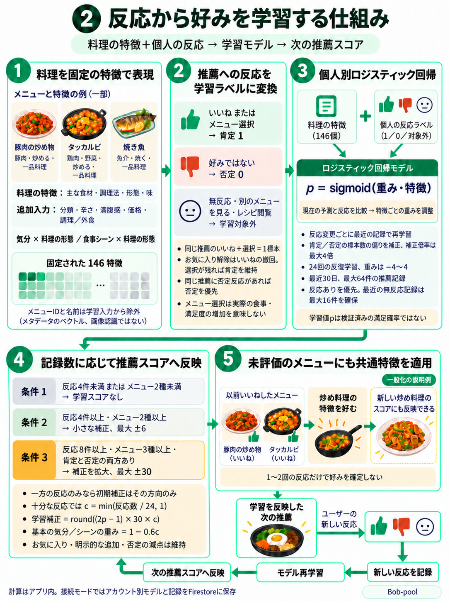
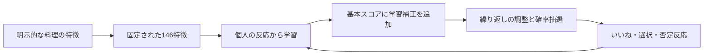

# フィードバック学習モデル





学習モデルは`version=2`・146特徴を使います。[接続版・デモAPK](APK.md)で同じ推薦・学習構造を体験できます。

アカウント別のコンテンツベースのロジスティック回帰で、明示的な反応から重みを学習します。予算・辛さ・明示的な除外は常に必須条件です。学習と推論はFlutterアプリのDartコードで実行し、有料APIや別学習サーバーは不要です。接続モードはモデル・推薦記録・好みを1つのFirestoreトランザクションで保存します。デモも同じ計算を使い、端末内に保存します。

<br><br><br>


## 入力と反応

既存レシピを基に100メニューの主な食材・調理法・形態・味を`food_traits`に分類しました。編集用の特徴であり、全材料・栄養・アレルギー・菜食を保証しません。[分類基準](FOOD_TRAITS.md)

メニューIDと名前は入力から除外します。[固定一覧](../../lib/models/learning_feature_schema.dart)の各位置に特徴を割り当て、L2正規化します。146次元の内訳は分類12・食材9・調理法8・形態8・味4・辛さ3・満腹感3・調理／外食2・予算に対する価格1・気分×形態48・シーン×形態48です。特徴の意味や順序を変える場合はモデルバージョンも変えます。

| 反応 | 学習処理 |
|---|---|
| いいね、またはメニュー選択 | 肯定標本1 |
| 好みではない | 否定標本0、既存の-60点も維持 |
| 同じ推薦でいいね後に選択 | 肯定標本は一つ、選択回数も一回 |
| お気に入り解除 | いいねを撤回。選択が残れば肯定を維持 |
| 無反応・別メニュー・レシピ閲覧 | 学習ラベルなし |
| 肯定後、同じ推薦で否定 | 否定標本に変更 |
| 気分設定の初期化 | その気分の学習記録も削除 |
| 気分にメニューを再追加 | その気分・メニューの過去の否定学習を削除 |

通常のお気に入り一覧から解除すると、保持中のそのメニューのいいねを撤回します。ランダムモードは個別条件・学習スコアを使わず、学習標本も作りません。古い累計選択回数は当時の条件がないため自動で学習ラベルにしません。選択は食事実績や満足の証拠ではなく、明示的なアプリ反応です。

<br><br><br>


## 計算とスコアへの反映

`p = sigmoid(w · x)`を使い、ログ損失の勾配で重みを更新します。反応変更ごとに最近の記録から再学習し、撤回・否定・期限切れを反映します。最大64表示、24学習反復、学習率`0.4 / sqrt(epoch + 1)`、L2規制0.01、重み[-4, 4]を使います。

両方の反応がある場合はクラスの比重を`min(全標本数 / (2 × そのクラスの標本数), 4)`にし、一方だけなら1にします。少数側の特徴も学習するための補正で、適用条件の標本数は実際の件数のままです。出力は満足確率ではありません。これらは初期設計値で、ユーザー実験による最適値ではありません。[SGDとロジスティック回帰](https://scikit-learn.org/stable/modules/generated/sklearn.linear_model.SGDClassifier.html)を参考にし、scikit-learnの実行やモデル変換を使わずDartで実装しました。

反応4件・異なるメニュー2種から`round((2p - 1) × 6 × min(n / 8, 1))`を最大±6点で適用します。肯定だけなら加点、否定だけなら減点のみで、反対方向を0にします。無反応を否定標本にはしません。

反応8件以上、肯定・否定各1件以上、異なる3メニュー以上では`c = min(n / 24, 1)`、`round((2p - 1) × 30 × c)`を最大±30点で適用します。この場合、基本の気分・シーンを`1 - 0.6c`倍にします。24標本から気分は+12、シーンは+10になります。明示的に追加した気分の+30と追加+15、お気に入り+20、選択回数、否定-60は維持します。

4件・2メニュー未満、または`LEARNING_ENABLED=false`なら、学習補正とタグ縮小を使いません。補正だけで否定の-60点を相殺することはできません。最終抽選はSoftmax（温度10）90%と探索10%です。[推薦設計](ALGORITHM.md)

モデル出力と抽選確率は異なり、どちらも検証済みの満足確率ではありません。学習反映は既存の推薦理由欄に表示します。

<br><br><br>


## 保存・重複・保持

`users/<UID>/preferences/current`の`values.learning`に保存します。

```text
version=2 / weights[146] / sampleCount / positives / negatives / distinctMenus
events[最大64]:
  id / menuId / mood / situation / budget / spicy
  featureVersion=2 / features[146] / candidateIds / drawProbability / score / policy
  policyVersion=3（過去の記録は当時のポリシーを維持）
  createdAt / feedbackAt / liked / selected / disliked
```

抽選時に表示IDと条件・実際の候補・確率・スコア・特徴を保存し、反応時の新しい好みで過去の判断を再計算しません。保持中の同じIDを再送しても表示・選択・標本は重複しません。トランザクション再実行も独立したコピーで計算します。

保持期間を過ぎた古い画面の反応は拒否し、再推薦を案内します。`lastExposureId`と最後の推薦時刻で、保持から外れた記録の再送による表示回数の重複も防ぎます。

最近30日以内の最大64件を使い、反応ありを優先します。最近の無反応に最大16枠を確保するため、多くの無反応を通過しても最大48件の反応記録を保護できます。反応が少なければ残りに無反応を保存し、全件に反応があれば最大64件です。30日を過ぎた反応を永久保持する方式ではありません。

バージョン1のハッシュ重みを新特徴に適用せず、当時のメニュー・条件で特徴を再構成して学習します。読み取りは変換結果だけを使い、次の通常の変更時に同じトランザクションでバージョン2を保存します。お気に入り・選択・表示回数・旧抽選確率は維持します。期限切れと現在のデータにないメニューは学習から除き、未知バージョンや破損データは勝手に変換しません。明示的な初期化で復旧できます。

運用ルールはバージョン1の64重みとバージョン2の146重みを許可します。既存アカウントは一括変更せず、次の通常変更で変換します。`policy`は旧文字列を維持し、`policyVersion=3`で現在の抽選方針を区別します。期限切れ・未来時刻は計算から除き、次の変更時に保存文書からも削除します。**未使用アカウントの自動削除やFirestore TTLは設定していません。**

気分初期化で関連学習を消し、`resetLearning()`で全モデル・学習を初期化できます。お気に入り・選択履歴は別データとして残ります。専用の追加UIは作っていません。ルールは本人アクセスと最上位構造・バージョン・次元・標本数・ログ数を検査し、重みやイベント内部値はアプリが検査します。サーバーが学習の真偽を保証する構造ではありません。

<br><br><br>


## 比較と再現

学習反映を無効にして同じUIで比較できます。両モードとも10%探索を使い、記録収集・モデル更新は続けます。

```sh
flutter run --dart-define=DEMO_MODE=true --dart-define=LEARNING_ENABLED=false
flutter test --no-pub
dart run tools/evaluate_learning.dart
```

[合成評価JSON](../learning_evaluation.json)は、条件を満たす候補のID順で3番目ごとを評価用に残し、人工的な反応を作ります。評価IDは学習に含めません。豚肉／魚介では両方を含む料理を除き、焼き料理／揚げ物では該当2調理法だけを比べます。評価メニューの反応は学習に使いません。

| 合成シナリオ | 学習／評価メニュー数 | 均等クラス平均ログ損失 | 規則＋探索の肯定候補確率 | 学習＋探索の肯定候補確率 |
|---|---:|---:|---:|---:|
| スープ | 56 / 28 | 0.1871 | 21.14% | 94.79% |
| 洋食 | 56 / 28 | 0.4259 | 0.84% | 20.61% |
| 炒め料理 | 56 / 28 | 0.3990 | 33.79% | 70.06% |
| 豚肉を好み魚介を避ける | 28 / 15 | 0.3586 | 72.94% | 96.87% |
| 焼き料理を好み揚げ物を避ける | 8 / 5 | 0.2995 | 82.79% | 91.59% |

学習・一般化・抽選反映を確認する機械的評価です。確率は人工的な好みに合う集合への配分で、実際の精度や満足度の改善率ではありません。均等クラス損失は肯定・否定それぞれの平均損失を同じ比重で平均します。通常損失とクラス比率基準もJSONにあります。洋食の通常損失0.3267は比率基準0.2602より大きく、すべての指標が改善するわけではありません。洋食の抽選割合も20.61%です。[学習前後比較](evaluations/FEEDBACK_LEARNING_COMPARISON.md)

反応した料理からのみ学ぶ表示バイアスがあります。逆確率補正、コンテキストバンディット、因果評価、実際のA/B実験は実装していません。

<br><br><br>


## コードと検証

- [学習エンジン](../../lib/services/feedback_learning_engine.dart)：特徴、回帰、補正、期限切れ。
- [反応記録](../../lib/services/learning_feedback_recorder.dart)：訂正、重複防止、同一トランザクション。
- [固定特徴](../../lib/models/learning_feature_schema.dart)・[記録モデル](../../lib/models/learning_model.dart)
- [繰り返し調整](../../lib/services/recommendation_diversity.dart)
- テストは未学習メニューへの一般化、気分別の反対の好み、初期状態、必須条件、反応撤回、アカウント分離、保持上限、サーバー再取得を確認します。

[検証記録](VERIFICATION.md)・[ERD](ERD.md)
