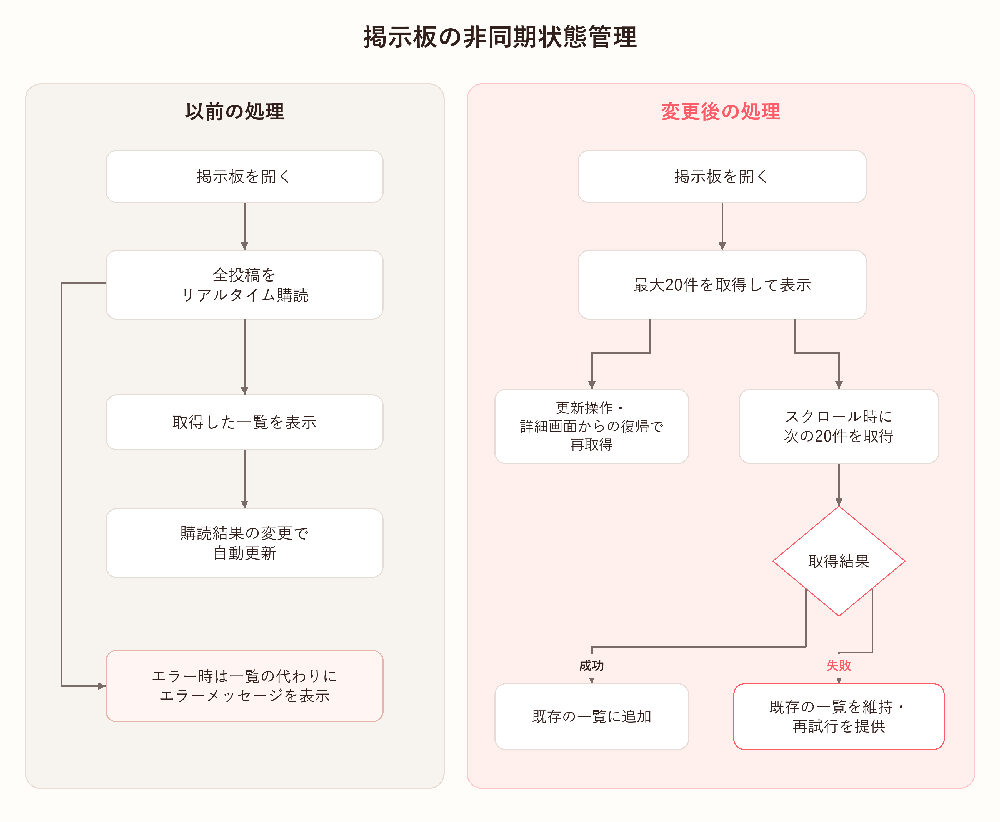

# 掲示板の非同期状態管理

   

## 処理の構造

全投稿をリアルタイム購読する方式から、**20件ずつ取得し、スクロール時に次のページを読み込む方式**へ変更しました。

ページ取得への変更に合わせ、読み込み・重複リクエスト・再試行・更新前の応答を共通の一覧ウィジェットで管理しました。

   

## 以前の方式の課題

以前は掲示板を開くと全投稿をリアルタイム購読し、取得した一覧を表示していました。投稿の変更を自動反映できる一方、取得範囲とエラー後の復旧に課題がありました。

| 課題 | 原因 |
|---|---|
| 投稿が増えるほど初回取得のデータが増える | `getPostsStream()`に件数制限がなく、最新の数件だけ読む場合も全投稿を取得してモデルに変換する |
| 取得エラー後に一覧を見続けたり再試行したりしにくい | `StreamBuilder`が一覧の代わりにエラーを表示し、再試行ボタンや引っ張って更新する操作がない |

例えば投稿が100件ある場合、最初の数件だけ読んで画面を閉じても、クエリは100件を取得していました。

   

## 解決の過程

全一覧の購読をページ取得に変更し、応答を画面に反映する条件を共通管理しました。

### 1. 取得状態を共通ウィジェットに分離

以前は`StreamBuilder`で読み込み・エラー・空一覧を表示していました。変更後は`BoardPagedList`が現在の一覧、読み込み状態、エラー、最後の取得位置、次ページの有無を管理します。

掲示板画面は取得関数と投稿表示用ウィジェットを渡します。初回の読み込みと、一覧下部に表示する追加取得の読み込みも区別しました。

### 2. 重複リクエストと失敗後の再試行

20件ずつ取得し、最後に取得した文書をカーソルとして次の範囲を読み込みます。初回は1ページだけ取得し、スクロールや追加読み込みボタンで次ページを要求します。

取得中は追加リクエストを止め、次のデータがなければ取得を終了します。追加取得に失敗した場合は一覧とカーソルを維持し、再試行ボタンを表示します。再試行は失敗した位置から続けます。

### 3. 更新前の応答を区別

追加取得の完了前に更新操作をすると、古い応答が新しい一覧に混ざる可能性があります。このためリクエストの世代を区別しました。

更新時に一覧とカーソルを初期化し、`_generation`を増やします。応答時に送信時の世代と現在の世代を比較し、一致した結果だけを反映します。送信済みの要求を取り消す方式ではなく、古い応答を反映しない方式です。`mounted`で画面が閉じられていないかも確認します。

### 4. 画面復帰と更新操作で再取得

ページ取得への変更後は、引っ張って更新したときや、投稿・詳細画面から戻ったときに最初のページから再取得します。空一覧もスクロール可能な領域に置き、投稿がなくても更新できるようにしました。

   

## 結果

### 1. 投稿が増えても初回取得は最大20件

実際のAndroid端末とFirestoreで、**投稿20・100・500件の条件を追加して以前の方式と比較**しました。同じSDKとログインセッションで、全件購読の最初のサーバー応答と最大20件取得を交互に実行しました。各条件でウォームアップ4組を除き20組を集計しました。

| 投稿数 | 以前の返却数 | 現在の返却数 | 以前の中央値 | 現在の中央値 | 応答時間の減少率 |
|---|---:|---:|---:|---:|---:|
| 20 | 20件 | 20件 | 527.939ms | 529.021ms | -0.2% |
| 100 | 100件 | 20件 | 1,265.898ms | 486.253ms | 61.6% |
| 500 | 500件 | 20件 | 4,880.662ms | 461.766ms | 90.5% |

**20件では応答時間はほぼ同じで、100件では約61.6%、500件では約90.5%減少しました。** 20件の-0.2%は約1.1ms増加した値であり、少量のデータでも一律に速くなるという結果ではありません。

旧版の取得コードを同じSDKで再現した比較です。時間にはネットワークとSDKの処理を含みます。1端末・1セッションの初回取得応答の比較であり、アプリ全体の速度改善率ではありません。[投稿数別の取得結果](../evaluations/BOARD_SERVER_SCALE_COMPARISON.md)

### 2. 追加取得に失敗しても一覧を維持して再試行

次ページの取得に失敗しても、読んでいた一覧を維持し、下部の再試行ボタンで再取得できます。初回取得の失敗時にも再試行ボタンを表示します。

ウィジェットテストで次ページの取得エラーを発生させ、既存項目が残ることと、再試行後の結果が一覧に追加されることを確認しました。

| 確認した状況 | 結果 |
|---|---|
| 次ページの取得失敗 | 表示済みの項目を維持 |
| エラー後の再試行 | 成功した結果を既存の一覧に追加 |
| 空一覧で引っ張って更新 | 再取得した投稿を表示 |

   

## 実装コード

| コード | 実装内容 |
|---|---|
| [投稿取得サービス](../../../lib/services/post_service.dart) | 20件単位の取得、並び順、カーソル |
| [共通一覧ウィジェット](../../../lib/widgets/board/board_paged_list.dart) | 読み込み・エラー・再試行、重複防止、古い応答の無視 |
| [掲示板画面](../../../lib/screens/board_page.dart) | ページ一覧の接続、画面復帰後の更新 |

---

[主な担当機能に戻る](../../../README.md#主な担当機能)
