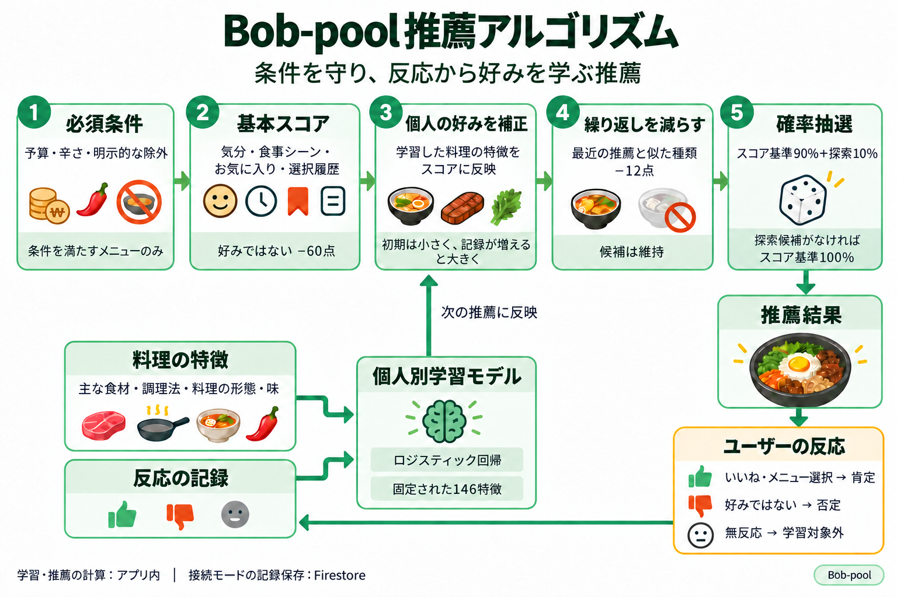

# 推薦アルゴリズム

   

## アルゴリズムの構造

予算・辛さ・明示的に除外したメニューを先に確認し、条件を満たした候補に気分・食事シーン・個人の好みを反映したスコアを付けます。最近推薦した料理と似たメニューは減点し、確率抽選で最終メニューを選びます。「いいね」・メニュー選択・「好みではない」の反応を次の推薦に反映します。

   

## 以前のアルゴリズムの課題

以前は、メニューに設定した気分・食事シーンのタグと入力予算の一致を優先順位ごとに確認していました。すべての条件を満たす候補がなければ条件を段階的に緩め、最初に候補が見つかった段階でランダムに選んでいました。苦手なメニューの除外や、気分ごとのメニューの追加・削除にも対応していました。

実装が単純で推薦基準を説明しやすい一方、次の課題がありました。

| 課題 | 原因 |
|---|---|
| 好みを別の料理に広げにくい | 除外や手動のタグ設定はできても、いいね・選択履歴と料理の特徴から新しいメニューの好みを学習しない |
| 同じ料理が繰り返し出やすい | 最初に条件を満たした候補内で抽選し、最近の表示履歴や料理の種類の繰り返しを確認しない |
| 最大予算の意味と価格判定が合わない | 入力予算が価格帯の中にあるかを判定するため、価格上限が予算を超えるメニューも候補になり、候補がなければ予算条件も緩める |

   

## 解決の過程

タグだけでは個人の好みと推薦の多様性を両立しにくいと考え、**入力条件を守りながら、ユーザーの反応で推薦が変わる仕組み**を設計しました。

### 1. 必須条件と好みの評価を分離

予算・辛さ・明示的な除外を推薦前に確認します。気分と食事シーンは候補を絞る唯一の基準にせず、スコアに反映しました。好みのスコアが高くても、必須条件を満たさない料理は推薦しません。

### 2. タグの一致と個人の反応を併用

気分・シーンの基本スコアに、お気に入りと選択履歴を加点し、否定反応を減点します。初期は基本スコアで推薦し、反応が増えると主な食材・調理法・形態・味を学習した補正を加えます。十分な肯定・否定反応が集まると、共通タグの影響を減らし、個人の反応を重視します。

### 3. 好きな料理の繰り返しも調整

好みのスコアだけを高くすると同じ料理が続くため、最近の推薦・選択履歴も確認します。最近出たメニューと似た種類は減点し、同じ再推薦セッションで表示済みのメニューは除外します。

### 4. スコアを確率に変換して選択

常に最高点のメニューを選ぶと推薦が固定されるため、Softmaxでスコアを抽選確率に変換しました。高いスコアの候補に大きな確率を与えつつ、ほかの候補にも選ばれる余地を残します。

抽選確率の90%はスコア、10%は表示回数が少ない探索候補に配分します。探索でも必須条件、否定反応、最近の推薦・選択、似た料理を確認し、探索候補がなければスコア基準の確率だけを使います。

   

## 結果

チームメンバーが使用した際、同じ気分・食事シーンでも以前より多様なメニューが出るという反応がありました。タグの一致に頼る方式から推薦の幅を広げ、一食を選ぶ際にさまざまな料理を検討できるようになりました。

いいね・メニュー選択・否定反応を記録した後は、個人の好みや苦手な料理が推薦に反映されやすいという評価を受けました。多様性と個人の好みを併せて考慮する仕組みは、チーム内の使用感でも好意的に受け止められました。

### 比較テスト

チーム内の感想とは別に、原版の推薦コードを変更せず実行して本方式と比較しました。気分5種・シーン6種、最大予算25,000ウォンの条件で、各方式につき100回の推薦を20回ずつ実施しました。

| 指標 | 原版 | 推薦アルゴリズム | 変化 |
|---|---:|---:|---:|
| 100回の推薦で出た異なるメニュー数 | 平均3.43件 | 平均59.71件 | **約17.4倍** |
| 似た料理が連続して出る割合 | 70.46% | 6.72% | 63.73ポイント減少 |
| 同じ仮想の好みの記録を反映した、好みに合う料理の推薦割合 | 平均20.00% | 平均79.27% | **59.27ポイント上昇** |

多様性の値は30条件の平均です。原版の価格帯判定と現在の最大予算判定で候補が変わる影響も含みます。10,000〜50,000ウォンでも追加比較し、改善幅は予算によって異なりました。

好みに合う料理の割合は、5種の仮想の好みに対して両方式に同じ肯定・否定記録を与え、シナリオごとに2,000回推薦した平均です。

[テスト条件と全結果](../evaluations/ORIGINAL_RECOMMENDATION_COMPARISON.md)

   

## 実装コード

| コード | 実装内容 |
|---|---|
| [推薦エンジン](../../../lib/services/recommendation_engine.dart) | 必須条件、気分・シーン・好みのスコア、学習補正、最近の記録 |
| [料理の種類の繰り返し調整](../../../lib/services/recommendation_diversity.dart) | 最近の推薦と似た料理かを判定 |
| [確率抽選](../../../lib/services/softmax_sampler.dart) | Softmaxの計算と探索確率の配分 |
| [推薦処理の連携](../../../lib/services/local_recommend_service.dart) | メニュー・好みの取得、候補計算、抽選、推薦記録 |
| [フィードバック学習](../../../lib/services/feedback_learning_engine.dart) | 料理の特徴と個人の反応から補正を計算 |

---

[主な担当機能に戻る](../../../README.md#主な担当機能)
